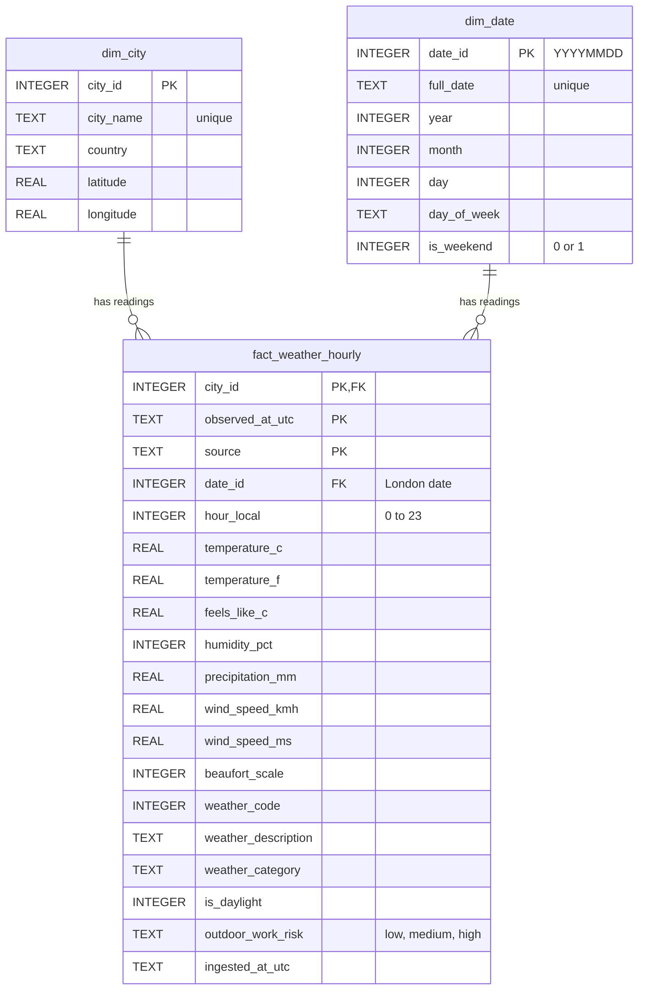
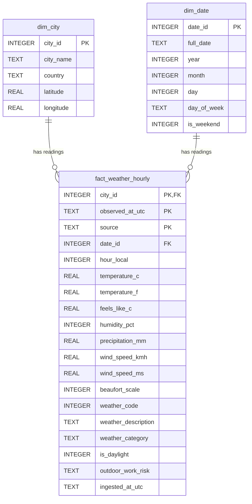

# WeatherFlow: Star Schema (ERD)

## Grain

**One row per city, per hour, per source.**

This is the grain of `fact_weather_hourly`. One row means one weather reading for one city, for one hour, from one data source (today `open-meteo`; a second source is planned for next week).

## Diagram

## Tables

| Table | Type | Primary key | What one row means |
|---|---|---|---|
| `dim_city` | Dimension | `city_id` | One city |
| `dim_date` | Dimension | `date_id` | One calendar day |
| `fact_weather_hourly` | Fact | `(city_id, observed_at_utc, source)` | One city, one hour, one source |

## Design decisions

- **Surrogate keys.** `city_id` is a simple number made by the database. The natural key `city_name` stays as a unique column. Renaming a city then never breaks the fact table.
- **`date_id` is an integer `YYYYMMDD`** (for example `20260701`). It is easy to read and sorts correctly.
- **`date_id` is the London (local) date**, taken from `observed_at_local`, because the business plans by UK calendar day. A reading at 23:30 UTC on 30 June is 1 July in London.
- **`observed_at_utc` stays in the fact table.** It is the exact moment and is used in the primary key.
- **`source` is in the primary key.** Two sources can report the same city and hour. Without `source`, the second one would overwrite the first.
- **Foreign keys are enforced** with `PRAGMA foreign_keys = ON;` on every connection.
- **`outdoor_work_risk`** has a CHECK constraint: it must be `low`, `medium` or `high`.

## Load rules

- Dimensions are loaded first (`dim_city`, `dim_date`), then the fact table.
- Every load uses upserts (`INSERT ... ON CONFLICT DO UPDATE`), so running it again replaces rows instead of duplicating them.
- The whole load runs in **one transaction**. If any row fails, nothing is committed.

# WeatherFlow: Star Schema (ERD)

## Grain

**One row per city, per hour, per source.**

## Diagram

## Notes

- `date_id` is the London (local) date as `YYYYMMDD`.
- The fact table's primary key is `(city_id, observed_at_utc, source)`.
- `source` is in the key because a second weather source is added next week.
- `outdoor_work_risk` must be `low`, `medium` or `high`.